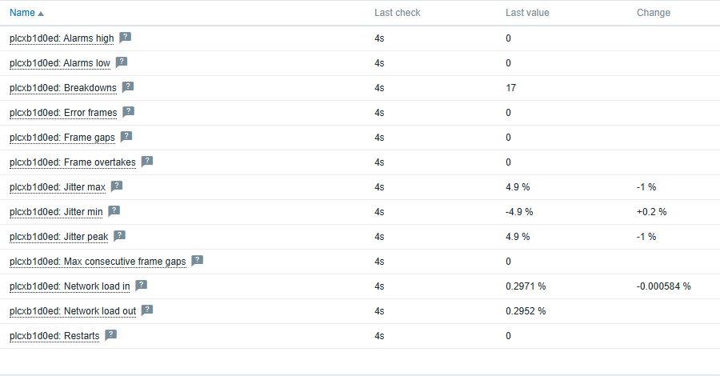
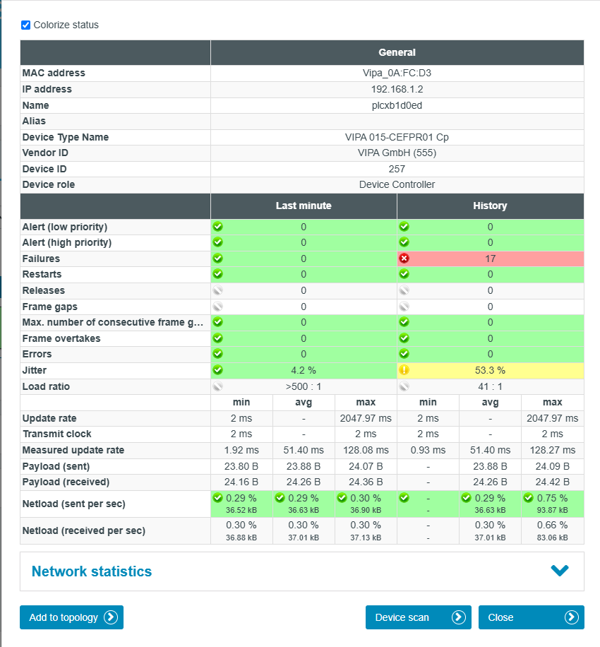

# INspektor-Zabbix

Monitor PROFINET, EtherNet/IP and PROFIBUS networks in Zabbix with the
**Indu-Sol INspektor NT**.

The INspektor NT sits on an industrial network and measures its health for every
device: breakdowns, frame gaps, jitter, network load, error and repeat telegrams.
This project brings those measurements into Zabbix, where they get Zabbix triggers,
graphs, dashboards and escalations like any other monitored system.

```
INspektor NT  --HTTP-->  INspektor-Zabbix collector  --trapper 10051-->  Zabbix server / proxy
 (OT network)               (Windows PC)                                  + INspektor template
```

The collector only reads from the INspektor and only pushes to Zabbix. Nothing
connects into the OT network from outside.

## What it looks like

The same PLC on a live PROFINET network, in Zabbix and on the INspektor NT web page.
Counters match the *History* column, jitter and network load match *Last minute*.

**Zabbix, Latest data:**



**INspektor NT web page for the same device:**



## Tested

| What | Result |
|---|---|
| Template import, discovery, values and triggers on a clean Zabbix 7.0.31 | 14/14 checks (`test/validate_template.py`) |
| Live PROFINET network, 6 devices, compared with the INspektor web page | Counters, network load and jitter formula match |
| Zabbix server down for 2 minutes | 340 values buffered, all delivered with original timestamps |
| `INspektor-Zabbix.exe` on a PC without Python | Works |

EtherNet/IP and PROFIBUS adapters are tested against recorded payloads; live
validation pending.

## What's in here

| Path | What it is |
|---|---|
| [`template/template_indusol_inspektor_nt/7.0/`](template/template_indusol_inspektor_nt/7.0/) | Zabbix template (YAML) and its full documentation: items, triggers, macros, discovery |
| `inspektor_zabbix.py` and modules | The collector source |
| `config.txt` | Collector configuration, the only file a customer edits |
| `Install-Task.ps1` | Registers the collector as a Windows scheduled task |
| `test/` | Throwaway Zabbix 7.0 in Docker plus a script that validates the template end to end |
| `tests/` | Unit tests, no hardware needed |

## Quick start

1. Import `template/template_indusol_inspektor_nt/7.0/template_indusol_inspektor_nt.yaml`
   in Zabbix (*Data collection > Templates > Import*).
2. Create one host per INspektor, named exactly like `NAME` in `config.txt`, and
   link the template for its protocol. Or let the collector do it:
   `INspektor-Zabbix.exe --provision`.
3. Edit `config.txt`: `ZABBIX_SERVER` and one block per INspektor.
4. `INspektor-Zabbix.exe --test`, every host must show `OK`.
5. `powershell -ExecutionPolicy Bypass -File .\Install-Task.ps1`

Details, every item and every trigger: see the
[template README](template/template_indusol_inspektor_nt/7.0/README.md).

## Collector commands

| Command | Does |
|---|---|
| `INspektor-Zabbix.exe` | Runs forever (what the scheduled task starts) |
| `--once` | One cycle, then exit |
| `--test` | Sends one heartbeat per host and explains any rejection |
| `--dump` | Saves the raw INspektor JSON to `dumps/` for support |
| `--provision` | Creates the host group and hosts through the Zabbix API (needs an API token) |

If Zabbix is unreachable, values are kept in `buffer.sqlite` with their original
timestamps and sent when the connection returns.

## Building from source

Python 3.10+, standard library only at runtime.

```
py -m pip install pyinstaller pyyaml pytest
py -m pytest tests -q
py tools/make_template.py          # regenerates the template YAML and its README
pyinstaller INspektor-Zabbix.spec
```

The metrics, the template and its README are all generated from `metrics.py`.
Add a metric there and in the adapter, then rerun `make_template.py`.

## Support

InduSol America / VIPA Controls America
Support@indusolamerica.com
